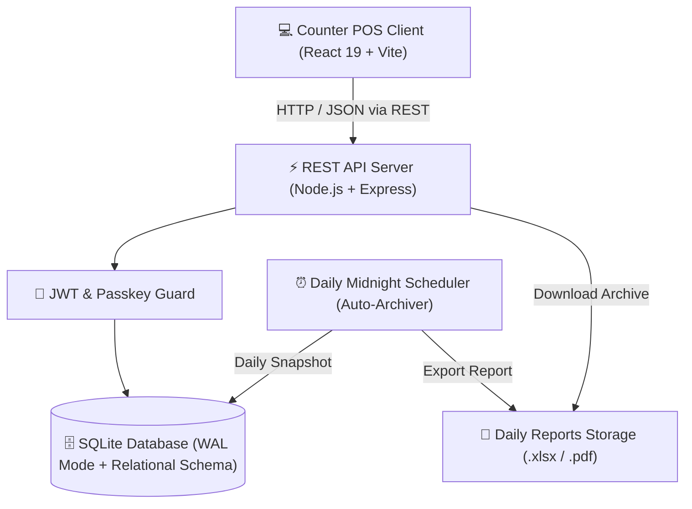

<p align="center">
  
  
  
  
  
  
</p>

<h1 align="center">🏥 MediFlow POS — Hospital Pharmacy Point-of-Sale & Clinical Inventory System</h1>

<p align="center">
  <strong>An enterprise-grade, clinical pharmacy dispensary counter POS and FEFO batch inventory management system.</strong><br>
  Designed for real-world healthcare compliance, hospital dispensary speed, multi-counter billing, and automated end-of-day financial closures.
</p>

<p align="center">
  <a href="#-key-features">Key Features</a> •
  <a href="#-system-architecture">Architecture</a> •
  <a href="#-quick-start">Quick Start</a> •
  <a href="#-demo-credentials">Demo Accounts</a> •
  <a href="#-rest-api-documentation">API Docs</a> •
  <a href="#-automated-testing">Test Suite</a> •
  <a href="#-free-cloud-deployment">Free Deployment</a> •
  <a href="#-license">License</a>
</p>

---

## 🌟 Overview

**MediFlow POS** is built from the ground up to solve hospital pharmacy challenges:
- **Zero Dispensing Errors**: Automatic block against dispensing expired medication at the checkout counter.
- **FEFO (First-Expiry-First-Out) Dispensing**: Prioritizes batches nearing expiration to prevent inventory write-offs.
- **Atomic Concurrency**: Built with SQLite in Write-Ahead-Logging (`WAL`) mode with ACID transactions, guaranteeing zero negative stock even during peak queue hours.
- **Automated Daily Shift Closure**: Scheduled midnight background cron jobs that generate encrypted Excel (`.xlsx`) and PDF receipts, archive sales, and reset the daily counter.

---

## ✨ Key Features

| Capability | Technical Implementation & Clinical Benefit |
| :--- | :--- |
| **💊 Smart POS Billing Counter** | Instant debounced search by Generic Name, Brand Name, or Dosage. Dynamic cart calculation with real-time tax breakdown, discount application, and thermal receipt printing. |
| **🛡️ Expiry Quarantine Engine** | Automatic 4-tier status detection: **Normal**, **Low Stock**, **Near Expiry (<90 days)**, and **Expired Quarantine**. Expired batches cannot be added to the cart under any condition. |
| **📦 FEFO Batch Inventory** | Supports multi-batch stock tracking per drug with batch numbers, manufacturing dates, expiry dates, purchase costs, and MRP margins. |
| **🔐 Role-Based Access Control (RBAC)** | Strict privilege separation between **Admin (Chief Pharmacist)** and **Cashier (Dispensary Counter)**, backed by JWT authentication and custom staff passkeys. |
| **⚡ Atomic Stock Reductions** | Uses transactional batch-level reservation on checkout to guarantee data consistency. |
| **📈 Reports & Daily Archives** | Real-time sales statistics, top-selling medications, daily revenue graphs, and automated downloadable daily audit logs (Excel & PDF). |
| **🎨 Medical Glassmorphism UI** | High-contrast, responsive clinical dark-mode user interface built with modern vanilla CSS design tokens for ultra-fast load times. |

---

## 🏗 System Architecture



---

## 🛠 Tech Stack

- **Frontend**: React 19, Vite, Lucide Icons, Pure CSS Design System (Zero heavyweight UI frameworks for lightning-fast kiosk response)
- **Backend**: Node.js, Express.js, CORS, Dotenv, ExcelJS, PDFKit
- **Database**: SQLite3 via `better-sqlite3` (WAL Mode enabled with Foreign Key constraints)
- **Security**: JWT (JSON Web Tokens), bcryptjs password hashing, granular RBAC middleware, 4-digit fast passkey verification
- **Testing**: Native Node.js Test Suite (118 integrated test cases across 8 suites)

---

## 🚀 Quick Start (Local Setup in 2 Minutes)

### Prerequisites
- [Node.js](https://nodejs.org/) (v18.x or newer recommended)
- `npm` (v9.x or newer)

### 1. Clone the Repository
```bash
git clone https://github.com/contacttamilselvan25-lang/hospital-pharmacy-pos.git
cd hospital-pharmacy-pos
```

### 2. Backend Setup
```bash
cd backend

# Install dependencies
npm install

# Initialize and seed the database with realistic clinical demo data
npm run db:seed

# Start backend server
npm run dev
```
> The backend server starts listening at **`http://localhost:5000`**.  
> Test health: `http://localhost:5000/api/health`

### 3. Frontend Setup (In a New Terminal)
```bash
cd frontend

# Install dependencies
npm install

# Start Vite development server
npm run dev
```
> Open your browser at **`http://localhost:5173`**.

---

## 🔑 Demo Credentials

The database is pre-seeded with sample users for testing and viva evaluation:

| Role | Username | Password | Quick Passkey | Permissions |
| :--- | :--- | :--- | :--- | :--- |
| **Chief Pharmacist (Admin)** | `admin` | `admin123` | `2306324052` | Complete system access: Inventory master, batch editing, user management, financial reports, and archives. |
| **Dispensary Counter (Cashier)** | `cashier01` | `cashier123` | `1111` | Counter POS billing, customer invoice lookup, receipt generation. |
| **Secondary Counter (Cashier)** | `cashier02` | `cashier123` | `2222` | Counter POS billing, sales receipts. |

*(Single-click demo login buttons are provided on the login page for instant access.)*

---

## 🧪 Automated Testing

MediFlow POS comes with an exhaustive test suite covering security, business logic, POS checkout integrity, and FEFO allocation:

```bash
cd backend
npm test
```

### Individual Test Suites:
```bash
node src/db/verify.js               # Schema integrity & constraints (20 tests)
node src/tests/test_auth.js         # Authentication, Passkeys & RBAC (16 tests)
node src/tests/test_dashboard.js    # Metric calculations & 4-tier alerts (15 tests)
node src/tests/test_inventory.js    # Batch management & FEFO sorting (14 tests)
node src/tests/test_pos.js          # Cart & stock deduction checks (15 tests)
node src/tests/test_reports.js      # Sales reports & analytics (17 tests)
node src/tests/test_security.js     # SQL injection & security audits (20 tests)
node src/tests/test_e2e_workflow.js # End-to-end full dispensary workflow (16 tests)
```

**Overall Coverage**: `118 / 118 passing (100%)` ✅

---

## 🌐 Free Cloud Deployment

### 1. Deploy Backend on [Render.com](https://render.com) (100% Free)
- Create a new **Web Service** pointing to your repository.
- **Root Directory**: `backend`
- **Build Command**: `npm install && npm run db:seed`
- **Start Command**: `npm start`
- Add Environment Variable:
  - `NODE_ENV` = `production`
  - `PORT` = `5000`
  - `JWT_SECRET` = `<any-strong-random-key>`

### 2. Deploy Frontend on [Vercel](https://vercel.com) (100% Free)
- Import your repository into Vercel.
- **Root Directory**: `frontend`
- **Build Command**: `npm run build`
- **Output Directory**: `dist`
- Add Environment Variable:
  - `VITE_API_BASE` = `https://<YOUR-RENDER-BACKEND-URL>.onrender.com/api`

---

## 🔒 Security Best Practices

- All authentication routes use **salted bcrypt** hashing.
- API endpoints enforce **Bearer JWT verification** and role validation.
- Database queries use **parameterized prepared statements** throughout to completely eliminate SQL injection vulnerabilities.
- Production environment configurations are managed via `.env` and are strictly excluded from git tracking.

---

## 📁 Repository Structure

```text
hospital-pharmacy-pos/
├── backend/
│   ├── archives/daily_sales/  # Automated Excel & PDF daily shift archives
│   ├── src/
│   │   ├── db/                # Connection, Relational Schema, and Seeders
│   │   ├── middleware/        # JWT & RBAC Auth Guards
│   │   ├── routes/            # Auth, Dashboard, Inventory, Sales, Reports
│   │   ├── services/          # Midnight Daily Scheduler & Report Exporters
│   │   ├── tests/             # 8 Comprehensive Integration Test Suites
│   │   └── server.js          # Express entrypoint
│   ├── .env.example
│   └── package.json
├── database/                  # SQLite local storage (pharmacy.db)
├── docs/                      # Technical Documentation & Viva Guides
├── frontend/
│   ├── src/
│   │   ├── App.jsx            # Dynamic Multi-Tab POS Kiosk UI
│   │   ├── App.css            # Component-level styling
│   │   └── index.css          # Medical Dark-Theme Design Tokens
│   ├── index.html
│   ├── vite.config.js
│   └── package.json
├── .gitignore
├── LICENSE
├── package.json
└── README.md
```

---

## 📄 License

This project is licensed under the [MIT License](LICENSE).

---

<p align="center">
  Crafted with care for healthcare professionals and clinical software developers.
</p>